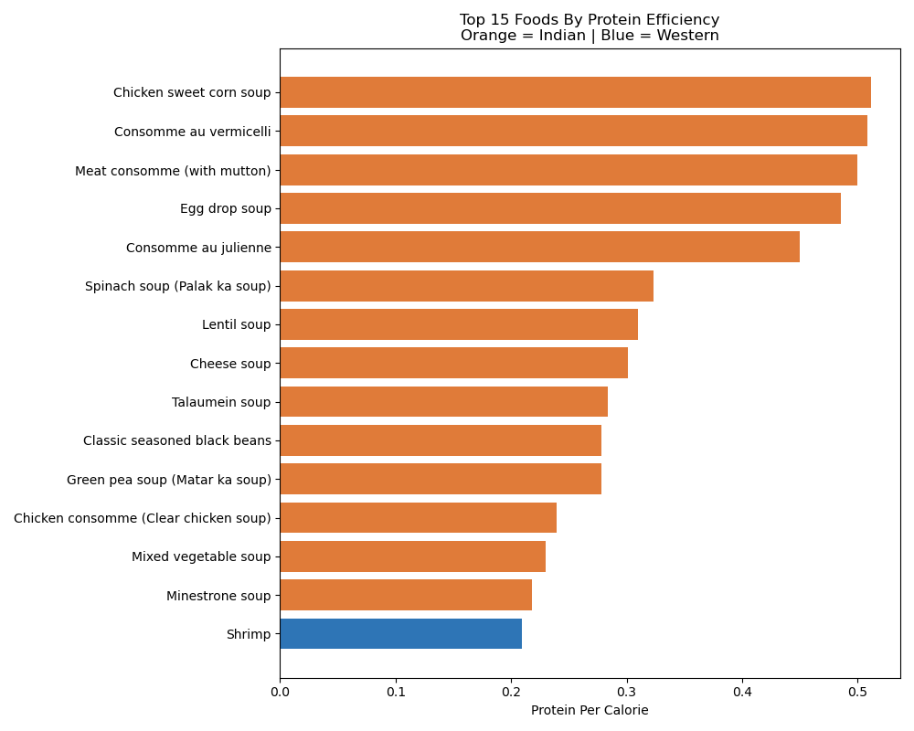

# Nutrition & Macro Analytics (Indian vs. Western Diets)

A Python and SQL data analytics project that helps fitness enthusiasts, coaches, and nutritionists find the most protein-efficient foods for their goals — built on a combined dataset of **1,274 Indian and Western food items** across **17 categories**.

## Problem

Most nutrition tools are built for Western diets. Indian foods — dal, sabzi, roti, khichdi — are missing from most datasets. Combining public datasets also introduces schema mismatches, trace values (`'t'`), and unit-scaling anomalies. This project solves both.

## What This Project Does

* **Data Cleaning & Merging (Pandas):** Cleans and merges real nutrition datasets (335 Western + 1,014 Indian foods) into 1,274 standardized records.
* **Feature Engineering:** Calculates protein efficiency (`protein_per_calorie`) for every food item.
* **Category & Outlier Analysis:** Identifies top protein sources by category using Pandas `groupby` and SQL `GROUP BY / HAVING` queries.
* **Goal-Based Lookup Functions:**
  * `get_food_info(food_name)` — returns full macro breakdown for any dish.
  * `get_high_protein_foods(calorie_limit)` — recommends top 10 high-protein foods under a target calorie budget.
* **SQL Data Quality & Cost Auditing (`sql/` & `docs/`):**
  * Profiles systematic vs. random missingness across 17 columns (`docs/data_quality.md`).
  * Enforces strict SQLite numeric schema on `Sat.Fat` (`'t'` trace values) in `Foods_cleaned`.
  * Audits exact vs. food-name duplicates, negative values (`French-fried`), and macro-calorie consistency.
  * Joins nutrition data with food pricing (`prices` table) to compare protein cost efficiency.

## Key Findings

* **Fish and Seafood** dominates category-level protein efficiency in Western foods (`21.13g` average protein per serving), led individually by **Shrimp (`0.209 g/kcal`)** and **Cod (`0.165 g/kcal`)**.
* **Why Group Averages vs. Individual Rankings Differ:** `Indian Dishes` average `4.75g` protein as a broad category, whereas individual soup entries (`Chicken sweet corn soup`, `Palak ka soup`) rank at the top of raw `protein_per_calorie` ratios — though Atwater calorie validation (`4P + 4C + 9F`) reveals source-level calorie under-reporting in 11 soup records.
* **Vegetables** average under **75 calories per serving** (`Vegetables F-P` at `66.2 kcal`, `Vegetables A-E` at `73.0 kcal`) — the best category for high-volume, calorie-controlled diets.

## Visualization

## Repository Structure

* `nutrition.ipynb` / `nutrition_basics.ipynb` — End-to-end Pandas & SQLite analysis notebooks
* `sql/` — Numbered SQL scripts (`01` to `06`) for counting, aggregation, schema cleaning, and anomaly checks
* `docs/data_quality.md` — Complete data quality investigation and missing-value taxonomy
* `nutrition_combined.csv` — Merged dataset (1,274 rows, 17 columns)

## Tech Stack

`Python` | `SQL (SQLite)` | `Pandas` | `Matplotlib` | `Jupyter Notebook`
